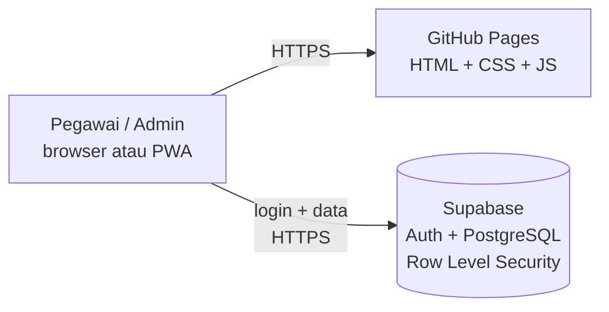
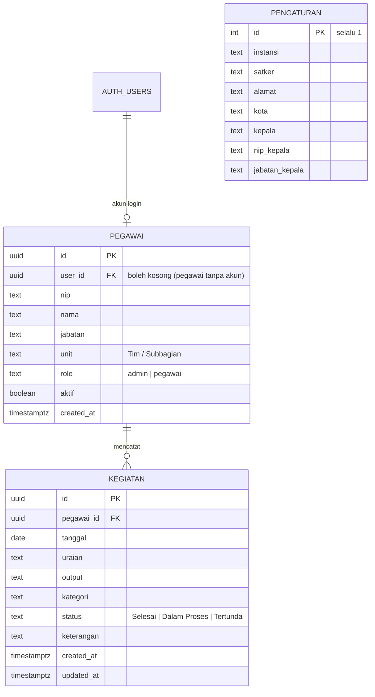
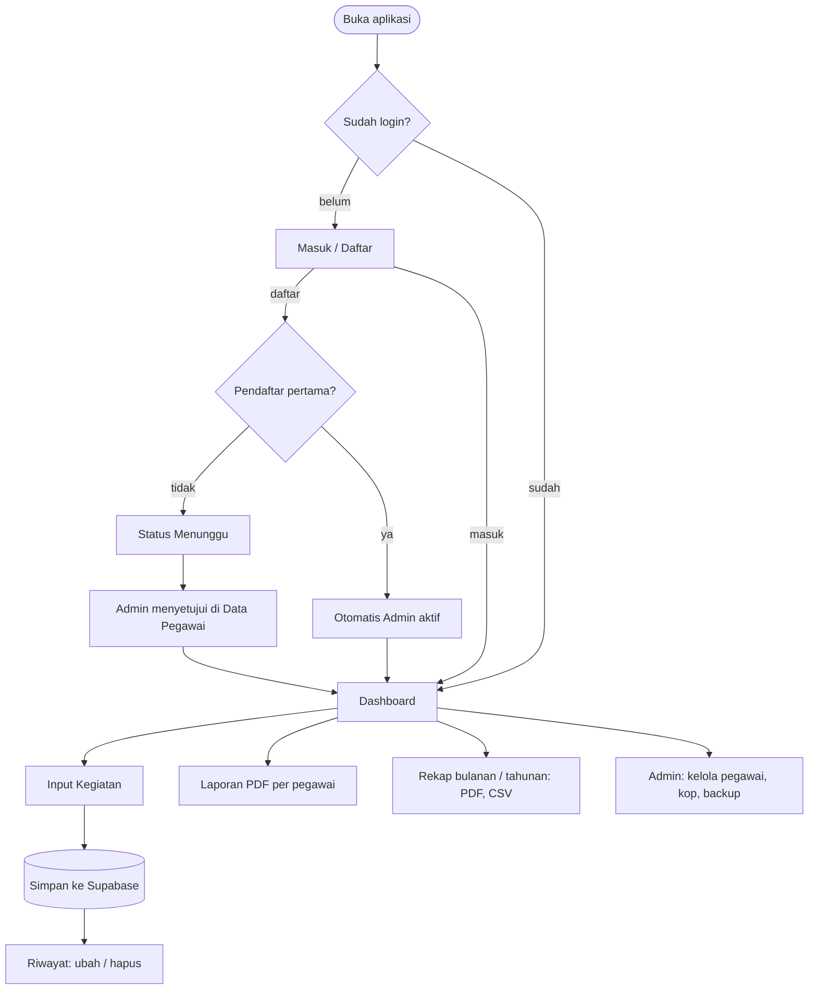

# Day-Log BPS (versi online)
**Sistem Informasi Kegiatan Harian Pegawai** - Badan Pusat Statistik

Day-Log (Daily Work Log) adalah aplikasi web online dengan **login per pegawai**, **database terpusat**, laporan PDF, serta rekap bulanan dan tahunan. Bisa dipasang di HP atau laptop seperti aplikasi biasa (PWA). Frontend di-host gratis di **GitHub Pages**, data tersimpan di **Supabase** (PostgreSQL).

---

## 1. Arsitektur



- **GitHub Pages** hanya menyajikan file statis.
- **Supabase** menyimpan akun dan data. Keamanan ditegakkan di database lewat **Row Level Security (RLS)**, bukan hanya di tampilan: pegawai tidak bisa membaca atau mengubah kegiatan orang lain walaupun mencoba lewat konsol browser.
- Kunci `anon` di `js/config.js` memang publik. Jangan pernah menaruh `service_role` key di aplikasi.

---

## 2. Peran dan Hak Akses

| | Pegawai | Admin |
|---|---|---|
| Daftar / login sendiri | ya | ya |
| Input, ubah, hapus kegiatan **sendiri** | ya | ya |
| Input / ubah kegiatan **pegawai lain** | tidak | ya |
| Lihat riwayat, rekap, dan PDF | hanya miliknya | semua pegawai |
| Kelola pegawai (tambah, setujui akun, ubah peran) | tidak | ya |
| Atur kop instansi dan penandatangan | tidak | ya |
| Ubah profil dan password sendiri | ya | ya |

**Alur akun:** pendaftar **pertama** otomatis menjadi **Admin** aktif. Pendaftar berikutnya berstatus **Menunggu** sampai admin menekan **Setujui** di menu Data Pegawai. Sistem menolak penurunan atau penghapusan admin aktif terakhir.

---

## 3. Rancangan Database



Skema lengkap (tabel, indeks, trigger, kebijakan RLS) ada di **`supabase/schema.sql`**.

Fitur pengaman di database:
- `kegiatan.pegawai_id` memakai `ON DELETE RESTRICT`, jadi pegawai yang punya riwayat tidak bisa terhapus (cukup dinonaktifkan).
- Trigger `protect_last_admin` mencegah sistem tanpa admin.
- Pegawai tidak bisa mengubah perannya sendiri. Perubahan profil dilakukan lewat fungsi `update_profil` yang hanya menyentuh nama, NIP, jabatan, dan unit.
- Pengguna anonim (belum login) tidak punya akses apa pun ke tabel.

---

## 4. Struktur Menu

```
Day-Log BPS
├── MENU UTAMA
│   ├── Dashboard                    (semua)
│   ├── Input Kegiatan               (semua)
│   ├── Riwayat Kegiatan             (semua)
│   ├── Data Pegawai                 (admin)
│   ├── Laporan PDF                  (semua; "semua pegawai" khusus admin)
│   ├── Rekap Bulanan / Tahunan      (semua; pegawai hanya melihat datanya)
│   ├── Data Tim                     (admin)
│   └── Penilaian Tugas              (ketua tim)
└── PENGELOLAAN
    ├── Akun Saya                    (semua) profil + ubah password
    └── Data & Pengaturan            (admin) kop, penandatangan, backup
```

---

## 5. Alur Sistem



**Rutinitas yang disarankan**
- **Harian:** pegawai membuka aplikasi dan mengisi kegiatan.
- **Akhir bulan:** admin membuka Laporan PDF dan mengunduh semua pegawai, lalu Rekap Bulanan.
- **Akhir bulan:** admin mengunduh **Backup JSON** dan **CSV**, lalu menyimpannya di Google Drive kantor.

---

## 6. Setup (sekali saja, sekitar 15 menit)

### A. Buat database di Supabase
1. Daftar di **supabase.com**, lalu **New project**. Pilih region terdekat (misalnya Singapore) dan simpan password database.
   - Gunakan **akun organisasi atas nama kantor**, bukan akun pribadi, supaya tidak hilang saat ada pergantian tugas.
2. Buka **SQL Editor > New query**, tempel seluruh isi `supabase/schema.sql`, lalu **Run**.
3. Buka **Authentication** (bagian pengaturan Email):
   - Pastikan penyedia **Email** aktif.
   - Untuk kemudahan pemakaian internal, **matikan "Confirm email"**. Jika dibiarkan aktif, setiap pendaftar harus menekan link konfirmasi di email.
   - Pada **URL Configuration**, isi **Site URL** dengan alamat GitHub Pages Anda (langkah C).
4. Buka **Project Settings > API**, salin **Project URL** dan kunci **anon / public**.

### B. Isi konfigurasi
Edit `js/config.js`:

```js
window.Day-Log_CONFIG = {
  SUPABASE_URL: 'https://xxxxxxxx.supabase.co',
  SUPABASE_ANON_KEY: 'eyJ... (kunci anon / public)'
};
```

### C. Deploy ke GitHub Pages
1. Buat repository, misalnya `day-log-bps`, dan upload **seluruh isi folder** ini termasuk `js/vendor`, `icons`, dan `supabase`.
2. **Settings > Pages > Deploy from a branch > main > / (root) > Save**.
3. Alamat: `https://<username>.github.io/day-log-bps/`.

### D. Pertama kali dipakai
1. **Segera buka alamat tersebut dan daftar sebagai akun pertama.** Akun ini otomatis menjadi Admin. Lakukan sebelum alamat dibagikan ke siapa pun.
2. Buka **Data & Pengaturan**, isi kop, kepala, dan NIP penandatangan.
3. Bagikan alamat ke pegawai. Mereka mendaftar sendiri, lalu Anda menyetujui di **Data Pegawai**.
4. Pegawai yang tidak punya perangkat (mis. pengemudi) bisa ditambahkan admin sebagai **pegawai tanpa akun**, dan kegiatannya diinput oleh admin.

### E. Memasang seperti aplikasi
- **Android (Chrome):** menu titik tiga, lalu **Pasang aplikasi** (atau tombol **Pasang Aplikasi** di bar atas).
- **Laptop (Chrome/Edge):** ikon pasang di kolom alamat.
- **iPhone (Safari):** Bagikan, lalu **Tambah ke Layar Utama**.

---

## 7. Agar Bertahan Lama

| Hal | Catatan |
|---|---|
| **Paket gratis Supabase** | Proyek dijeda bila hampir tidak ada aktivitas database selama 7 hari. Pemakaian harian biasanya cukup, tetapi libur panjang bisa memicunya. Data tetap utuh dan proyek bisa diaktifkan lagi lewat tombol **Resume project** di dashboard Supabase. Paket berbayar tidak pernah dijeda. Untuk pemakaian resmi satu kantor, paket berbayar lebih aman. Cek kebijakan terbaru di [dokumentasi Supabase](https://supabase.com/docs/guides/platform/free-plan-pausing). |
| **Backup** | Unduh Backup JSON dan CSV tiap akhir bulan dari **Data & Pengaturan**. Ketersediaan backup otomatis di Supabase tergantung paket. |
| **Pemilik akun** | Daftarkan akun Supabase dan GitHub atas nama kantor, dan beri akses minimal 2 orang. |
| **Pembaruan** | Edit file di GitHub, lalu GitHub Pages memperbarui otomatis. Aplikasi memakai strategi network-first, jadi pengguna mendapat versi terbaru saat online. |
| **Jumlah data** | Aplikasi memuat data 2 tahun terakhir (tahun ini dan 2 tahun sebelumnya) supaya tetap cepat. Data lama tetap aman di database. |
| **Domain sendiri** | Opsional: GitHub Pages mendukung domain khusus (Settings > Pages > Custom domain). |

---

## 8. Isi PDF Laporan Per Pegawai

1. **Kop:** nama instansi, satuan kerja, alamat (opsional), garis ganda
2. **Judul:** LAPORAN KEGIATAN HARIAN PEGAWAI
3. **Identitas:** Nama, NIP, Jabatan, Tim / Subbagian, Periode
4. **Tabel:** No, Hari / Tanggal, Uraian Kegiatan, Output, Status, Keterangan
5. **Ringkasan:** total kegiatan, selesai, dalam proses, tertunda, hari terisi
6. **Tanda tangan:** Pegawai dan Kepala
7. **Footer:** tanggal cetak dan nomor halaman

---

## 9. Struktur Folder

```
day-log-bps/
├── index.html
├── manifest.webmanifest      PWA
├── sw.js                     service worker
├── css/style.css
├── js/
│   ├── config.js             <- isi URL dan anon key Supabase di sini
│   ├── app.js
│   └── vendor/               supabase-js, jsPDF, autoTable (sudah disertakan)
├── icons/                    ikon aplikasi
├── supabase/schema.sql       <- jalankan di SQL Editor Supabase
└── README.md
```

---

## 10. Pemecahan Masalah

| Gejala | Penyebab / solusi |
|---|---|
| Muncul layar "Konfigurasi belum lengkap" | `js/config.js` belum diisi atau belum ter-upload. |
| "Email atau password salah" padahal benar | Jika "Confirm email" aktif, email harus dikonfirmasi dulu. |
| Setelah daftar, muncul "Menunggu persetujuan admin" | Normal. Admin menyetujui di Data Pegawai. |
| "Tidak memiliki izin" saat menyimpan | Akun belum aktif, atau mencoba mengubah data milik orang lain. |
| Tidak bisa terhubung ke server | Periksa internet. Pada paket gratis, proyek mungkin sedang dijeda (Resume di dashboard Supabase). |
| Tampilan lama setelah update | Muat ulang halaman sekali (Ctrl+F5). |


## 8. Pembaruan Day-Log
- Nama dan identitas aplikasi diperbarui menjadi **Day-Log (Daily Work Log)**.
- Dashboard Admin menyediakan monitoring harian berdasarkan tanggal, daftar pegawai yang sudah/belum mengisi, serta monitoring bulanan dengan progress bar.
- Akhir pekan (Sabtu dan Minggu) serta tanggal merah/cuti bersama tidak dihitung sebagai hari kerja pada progress bulanan dan peringatan laporan. Admin dapat mengelola kalender hari libur di menu **Data & Pengaturan**: muat otomatis dari API atau tambah/hapus manual (misalnya libur daerah).
- Form kegiatan memiliki kolom **Link Bukti Dukung**. Tempel tautan HTTPS ke file/folder Google Drive atau OneDrive. Pastikan izin berbagi diberikan kepada pihak yang berwenang.
- Rekomendasi penyimpanan bukti: satu folder induk instansi, lalu subfolder per pegawai dan per tahun/bulan. Pada setiap laporan, tempel tautan langsung ke file atau subfolder bukti yang relevan.
- Kolom persentase/kepatuhan dihilangkan dari **PDF Rekap Bulanan** sesuai arahan; tabel monitoring aplikasi tetap menampilkan progress bar.

### Penting: jalankan pembaruan database
Setelah mengganti file aplikasi, buka Supabase Dashboard → SQL Editor, lalu jalankan perintah berikut satu kali untuk menambahkan kolom link bukti dukung dan kalender hari libur pada database lama:

```sql
alter table public.kegiatan add column if not exists evidence_url text;

create table if not exists public.hari_libur (
  tanggal     date primary key,
  keterangan  text not null default '',
  sumber      text not null default 'manual' check (sumber in ('api', 'manual')),
  created_at  timestamptz not null default now()
);

alter table public.hari_libur enable row level security;
revoke all on public.hari_libur from anon;

drop policy if exists hari_libur_select on public.hari_libur;
create policy hari_libur_select on public.hari_libur for select to authenticated
  using (public.my_pegawai_id() is not null);
drop policy if exists hari_libur_insert on public.hari_libur;
create policy hari_libur_insert on public.hari_libur for insert to authenticated
  with check (public.is_admin());
drop policy if exists hari_libur_update on public.hari_libur;
create policy hari_libur_update on public.hari_libur for update to authenticated
  using (public.is_admin()) with check (public.is_admin());
drop policy if exists hari_libur_delete on public.hari_libur;
create policy hari_libur_delete on public.hari_libur for delete to authenticated
  using (public.is_admin());

grant select, insert, update, delete on public.hari_libur to authenticated;
```

Jika membuat proyek database baru, jalankan seluruh file `supabase/schema.sql` seperti biasa.


## Pembaruan tampilan Day-Log

Versi ini menggunakan identitas visual Day-Log dari aset `assets/day-log-logo.jpg` dan `assets/day-log-mark.png`.
Ikon PWA di folder `icons/` juga telah diperbarui. Halaman masuk/daftar kini memakai layout dua kolom
dengan panel pengenalan, form yang lebih lapang, serta penyesuaian responsif untuk ponsel.
Gaya tombol, navigasi, kartu, dan form aplikasi turut diselaraskan dengan palet biru-kuning logo.

Pembaruan ini mengubah tampilan frontend saja; alur login/registrasi, skema database, dan konfigurasi
Supabase tetap dipertahankan.


## Pembaruan: Ketua Tim, Asal Tim Tugas, dan Penilaian

**Fitur baru**
- **Data Tim** (admin): daftar tim kantor (11 tim) dan penunjukan **ketua tim** dari daftar pegawai. Menampilkan jumlah tugas yang diberikan tiap tim, jumlah yang sudah dinilai, dan rata-rata nilainya.
- **Input Kegiatan**: pilihan opsional **"Tugas berasal dari tim"**. Kategori kegiatan ditambah: Pengawasan, Supervisi, Pemeriksaan Dokumen, Validasi Data, Penyusunan Publikasi, dan Memberikan Konsultasi.
- **Penilaian Tugas** (menu muncul otomatis untuk ketua tim): ketua menilai kegiatan pegawai (dari tim mana pun) yang ditandai berasal dari timnya. Nilai 0-100 plus catatan opsional:

| Nilai | Kategori |
|---|---|
| 96-100 | Sangat Baik |
| 90-95 | Baik |
| 85-89 | Cukup |
| 0-84 | Kurang |

- Nilai dan catatan terlihat oleh pegawai yang dinilai (di Riwayat Kegiatan), ketua tim, dan admin.
- Dashboard ketua menampilkan pengingat jumlah tugas yang belum dinilai.

**Keamanan (di database, bukan hanya tampilan)**
- Ketua tim hanya dapat **melihat** kegiatan yang tugasnya berasal dari timnya, selain kegiatannya sendiri.
- Nilai hanya bisa diisi lewat fungsi `nilai_kegiatan` oleh ketua tim asal tugas. Pegawai dan admin tidak dapat mengubah nilai lewat update biasa, dan ketua tidak dapat menilai kegiatannya sendiri.
- Bila pegawai mengganti asal tim sebuah kegiatan, nilai lama otomatis dihapus.

### Penting: jalankan pembaruan database
Buka Supabase Dashboard, SQL Editor, tempel seluruh isi **`supabase/migrasi-ketua-tim.sql`**, lalu **Run** (sekali saja, aman diulang). Proyek baru cukup menjalankan `schema.sql` karena sudah termasuk. Sebelum SQL dijalankan, aplikasi tetap berjalan seperti biasa tetapi fitur tim belum aktif.

**Langkah awal setelah itu:** login admin, buka **Data Tim**, tambahkan 11 tim, lalu pilih ketua masing-masing.
